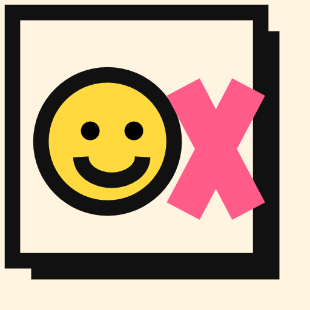
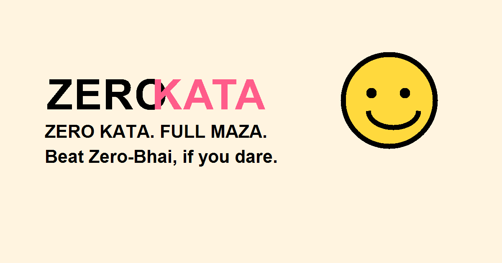

<div align="center">

  

  <h1>⚡ ZeroKata ⚡</h1>

  <p>
    <strong>India's Silliest Grid Fight · Zero Kata. Full Maza.</strong>
  </p>

  <p>
    A fast, funny, and modern Tic-Tac-Toe web game featuring <b>Zero-Bhai</b> — an AI opponent with witty banter, unbeatable algorithms, and zero chill.
  </p>

  <p>
    <a href="#-highlights--features">Features</a> •
    <a href="#-quick-start">Quick Start</a> •
    <a href="#-how-to-play--controls">How to Play</a> •
    <a href="#%EF%B8%8F-tech-stack">Tech Stack</a> •
    <a href="#-deployment">Deployment</a>
  </p>

  <p>
    
    
    
    
    
  </p>

  <br />

  

</div>

---

## 🌟 Highlights & Features

ZeroKata is not just another basic Tic-Tac-Toe clone. It is packed with personality, modern web capabilities, and smooth game feel:

### 🤖 Smart & Sassy AI ("Zero-Bhai")
- **Chill Mode (Easy):** Casual play for quick fun.
- **Thoda Dimaag (Medium):** Tactical blocks and smart center/corner prioritization.
- **Zero-Bhai Unbeatable (Hard):** Flawless decision-making powered by the **Minimax** algorithm with alpha-beta pruning. You can draw at best, but you cannot beat him!

### 👥 2-Player "Vs Friend" Mode
- Play pass-and-play matches locally on the same device.
- Add custom nicknames for Player X and Player O (*"Ab match personal hoga!"*).

### 🎭 Animated Mascot with Desi Banter
- Zero-Bhai reacts in real time to your moves, thinking states, victories, defeats, and draws.
- Dynamic SVG mascot expressions (Idle, Thinking, Shocked, Smug, Clapping, Shrug) and hilarious dialogue commentary.

### 🏆 Trophy Shelf & Achievements
Track your gaming milestones with saved achievements:
- 🥇 **First Blood:** Win your first match.
- 🔥 **On Fire:** Win 3 matches in a row.
- 🧠 **Grid Guru:** Win 5 matches.
- 🤝 **Peace Treaty:** Settle for 3 draws.
- ⚔️ **Full Maza:** Play 10 matches.

### 📱 Progressive Web App (PWA) & Offline Mode
- 100% installable on Mobile (Android/iOS) and Desktop (Chrome/Edge/Safari).
- Service worker caching ensures the game works seamlessly **without internet**.

### 🔊 Procedural Audio & Haptic Feedback
- Built-in sound effects generated on-the-fly using the native **Web Audio API** (zero audio file downloads).
- Haptic vibration feedback on supported mobile devices.

### 🎨 Modern UI & Accessibility
- Clean playful aesthetic with smooth micro-animations.
- **Dark Mode / Light Mode** toggle with instant local persistence.
- Full **Keyboard Navigation** (`Arrow keys` + `Enter`/`Space`) and screen reader support (ARIA labels).

---

## 🎮 How to Play & Controls

### Mouse / Touch
- Tap or click any empty grid tile to place your mark (`X` or `O`).
- Switch game modes, difficulty, and starter marks from the control panel.

### Keyboard Controls
| Key | Action |
| :--- | :--- |
| `↑` `↓` `←` `→` (Arrows) | Navigate across the 3×3 grid |
| `Enter` / `Space` | Place mark in focused cell |
| `Tab` | Cycle through interactive buttons and controls |

---

## 🚀 Quick Start

ZeroKata has **zero dependencies** and requires **no build step**.

### 1. Clone the repository
```bash
git clone https://github.com/DEEPANSHU-CODER2007/ZeroKata.git
cd ZeroKata
```

### 2. Run the game
Simply double-click `index.html` to open it in your browser, or start a lightweight local server:

**Using Python:**
```bash
python -m http.server 3000
```

**Using Node.js (`npx`):**
```bash
npx serve .
```

Then visit `http://localhost:3000` in your browser.

---

## 📁 Project Structure

```text
zerokata/
├── assets/
│   ├── favicon.svg      # Crisp vector favicon
│   ├── icon-192.png     # PWA app icon (192x192)
│   ├── icon-512.png     # PWA splash icon (512x512)
│   ├── logo.svg         # ZeroKata branded vector logo
│   └── og-image.png     # Social sharing & README preview card
├── index.html           # Semantic game markup & UI components
├── style.css            # Responsive layout, tokens, animations & dark mode
├── script.js            # Game engine, Minimax AI, audio synth & state
├── sw.js                # Service Worker for offline PWA caching
├── manifest.json        # Web app manifest configuration
├── 404.html             # Custom fallback page
└── README.md            # Project documentation
```

---

## 🛠️ Tech Stack

- **HTML5:** Semantic markup, accessible roles (`grid`, `gridcell`, ARIA live regions).
- **CSS3:** Custom properties (CSS variables), Flexbox & CSS Grid, responsive design, dark mode.
- **JavaScript (ES6+):** Minimax decision algorithm, LocalStorage state management.
- **Web Audio API:** Real-time synthesized audio tones (no audio files needed).
- **Service Worker:** Offline asset caching.

---

## 🌐 Deployment

Deploy ZeroKata to the web in seconds:

### GitHub Pages
1. Push your repository to GitHub.
2. Go to your repo's **Settings** → **Pages**.
3. Under **Branch**, select `main` and `/ (root)`.
4. Click **Save** — your game will be live in a few moments!

### Vercel / Netlify
- **Vercel:** Import your GitHub repository on [vercel.com](https://vercel.com/new). No build configuration needed.
- **Netlify:** Connect your repository or drag-and-drop the project folder to [Netlify Drop](https://app.netlify.com/drop).

---

## 📄 License

This project is open source and available under the [MIT License](LICENSE).

<div align="center">
  <sub>Made with ❤️ and full maza. Beat Zero-Bhai if you have the courage!</sub>
</div>
